# TriageU

App iOS para estudiantes universitarios que ayuda a **priorizar actividades académicas** (parciales, tareas, proyectos, exposiciones) según la materia, la fecha de entrega, el peso en la nota, el nivel de preparación y el tiempo estimado.

Microproyecto de **Desarrollo de Aplicaciones Móviles** (Electiva) · Universidad del Cauca · SwiftUI.

**Integrantes:** Aurelio José Muñoz Rios · Isabella Plaza Díaz · Isabella Perez Hoyos

---

## Capturas de pantalla

| Hoy | Mi ruta | Progreso |
|:---:|:---:|:---:|
| 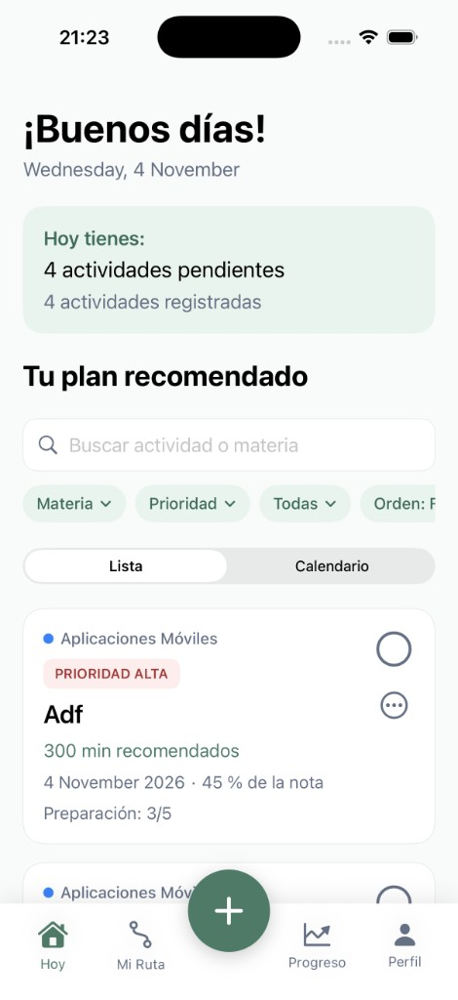 | 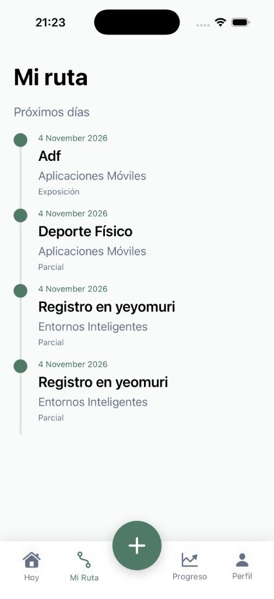 | 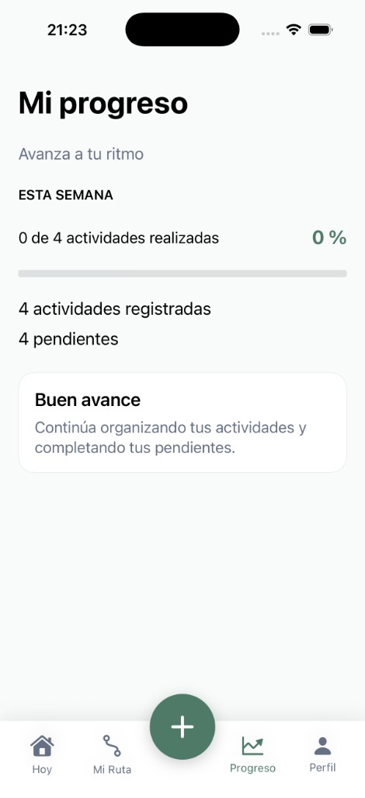 |
| Resumen, búsqueda, filtros, vista lista/calendario y tarjetas de actividad | Línea de tiempo de próximas entregas | Avance semanal de actividades completadas |

| Nueva actividad | Perfil | Acerca de |
|:---:|:---:|:---:|
| 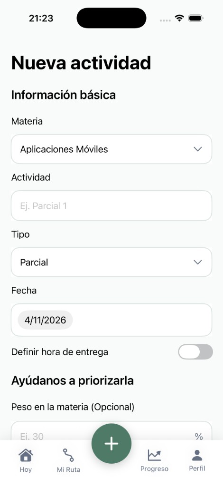 | 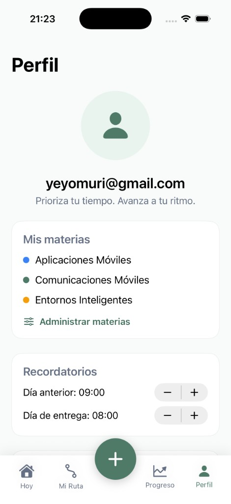 | 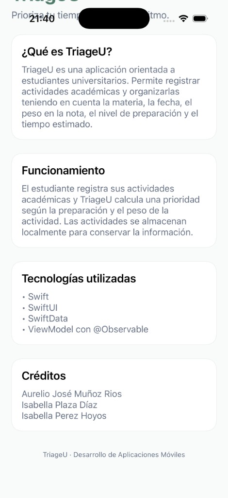 |
| Formulario con materia, tipo, fecha, hora opcional, peso, preparación y horas estimadas | Cuenta, materias editables y recordatorios | Descripción de la app, tecnologías y créditos (se abre desde Perfil) |

---

## Funcionalidades

- Registro, **edición y borrado** de actividades (con *deshacer* durante 5 s).
- **Prioridad automática** (ALTA / MEDIA / BAJA) calculada con la preparación y el peso en la nota.
- **Búsqueda y filtros** por materia, prioridad y estado; orden por fecha, prioridad o recientes.
- **Vista calendario** mensual con carga de horas por día y aviso de sobrecarga.
- **Materias editables** con color propio.
- **Hora de entrega opcional** por actividad.
- **Notificaciones locales** de recordatorio (horas configurables en Perfil).
- **Autenticación** con correo y contraseña (Supabase Auth) y recuperación de contraseña.
- **Sincronización en la nube** (Supabase) con resolución de conflictos por última escritura.
- **Modo sin conexión**: los cambios se encolan y se envían al volver la red.
- **Widget** de pantalla de inicio con las próximas entregas.

---

## Arquitectura

Patrón **MVVM** con persistencia local y servicios de red separados por módulos.

```
TriageU/TriageU/
├── TriageUApp.swift          Punto de entrada, ModelContainer y orquestación de sincronización
├── ContentView.swift         Navegación (barra inferior) y pantallas principales
├── Model/                    Entidades SwiftData: TriageActivity, Subject
├── ViewModel/                TriageViewModel (@Observable): formulario y cálculo de prioridad
├── View/                     AuthView, EditActivityView, SubjectsView, ActivityCalendarView, SetupView
└── Services/
    ├── SupabaseService.swift     Red: cliente REST (URLSession + Codable) y sincronización
    ├── SyncQueue.swift           Cola persistente de cambios pendientes (modo offline)
    ├── AuthManager.swift         Sesión de usuario (Supabase Auth), token en Keychain
    ├── Keychain.swift            Almacenamiento seguro de la sesión
    ├── NotificationService.swift Recordatorios locales
    └── WidgetBridge.swift        Datos compartidos con el widget (App Group)
TriageUWidget/                Extensión WidgetKit
```

| Capa | Implementación |
|---|---|
| **Vista** | SwiftUI (`@State`, `@Binding`, `@Bindable`, `@Environment`, `@Query`) |
| **ViewModel** | `TriageViewModel` con `@Observable`: estado del formulario, validación y prioridad |
| **Persistencia** | **SwiftData** (`TriageActivity`, `Subject`) como base de datos local |
| **Red** | **API REST de Supabase** (PostgREST + Auth) con `URLSession` y `Codable` |
| **Sincronización** | `SyncQueue` + `SupabaseService.sync`: *last-write-wins* por `updated_at` |

### Diagrama de capas

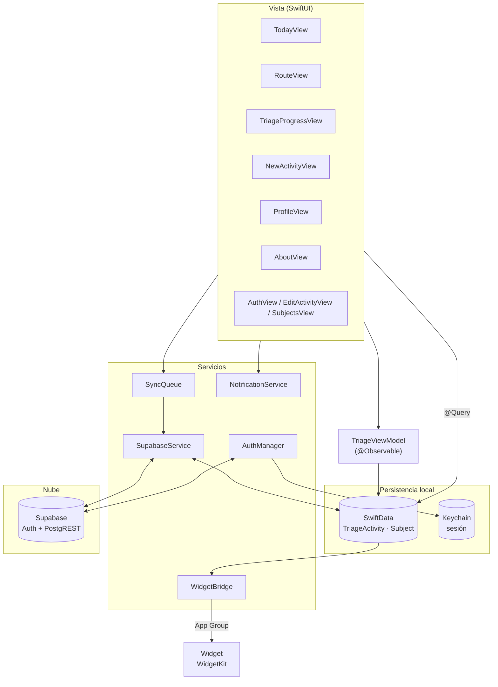

### Navegación entre pantallas

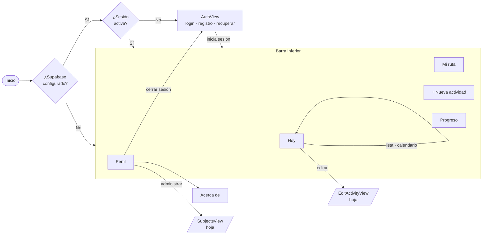

### Modelo de datos

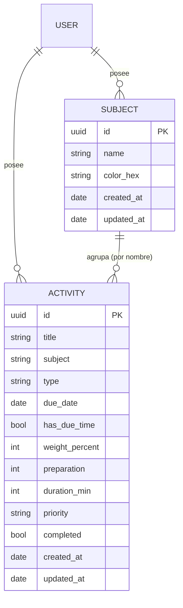

### Sincronización (guardar una actividad)

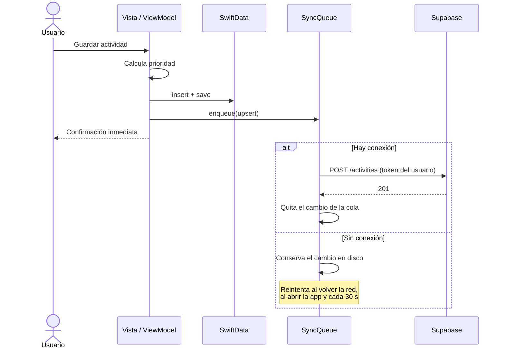

### Resolución de conflictos al sincronizar

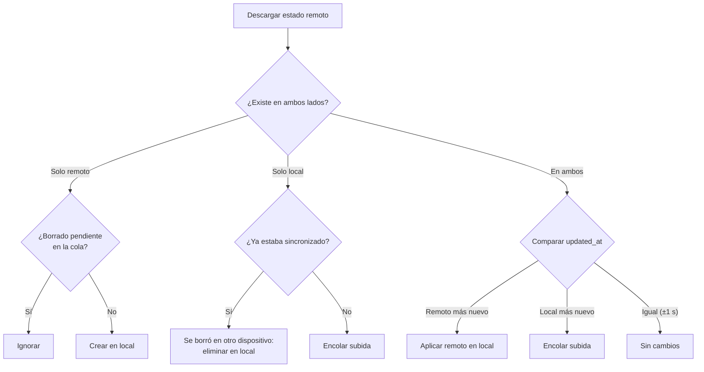

### Flujo de datos

1. El usuario crea o edita una actividad → se guarda en **SwiftData** (la app funciona sin red).
2. El cambio se encola en `SyncQueue` y se envía a Supabase en cuanto hay conexión.
3. Al abrir la app se descarga el estado remoto y se mezcla con el local.
4. Se reprograman las notificaciones y se actualiza el widget.

---

